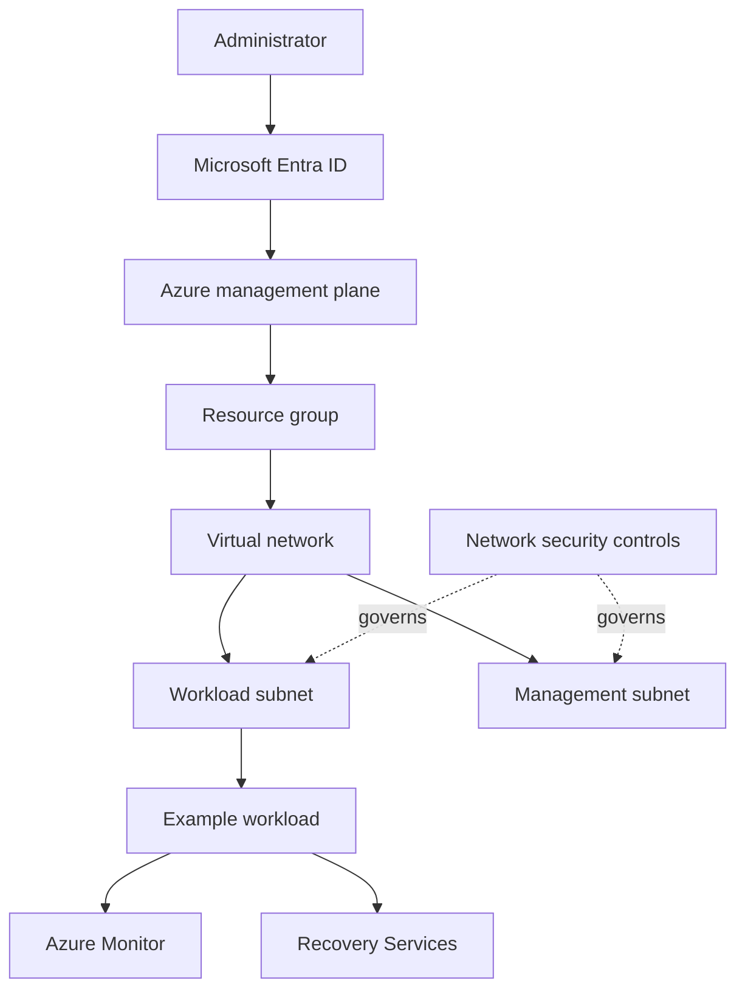

# Azure Cloud Labs

**Microsoft Azure | Hybrid cloud | Governance | Security | Operations**

Hands-on learning exercises for designing, deploying and operating secure Azure infrastructure. Labs should be repeatable, cost-conscious and safe for a personal test subscription.

## Lab principles

- Use a dedicated non-production subscription and least-privilege access.
- Set budget alerts and clean up billable resources after each exercise.
- Prefer parameterized templates and synthetic resource names.
- Never commit credentials, access tokens, tenant IDs or subscription IDs.
- Review current Azure documentation before applying portal or CLI steps.

## Learning path

| Level | Lab | Learning outcome |
|---|---|---|
| 1 | Resource groups, tags and locks | Organize and govern resources |
| 2 | Virtual networks and subnets | Understand address spaces and segmentation |
| 3 | Network security groups | Apply controlled traffic rules |
| 4 | Virtual machine hardening | Configure secure administration |
| 5 | Azure Monitor and Log Analytics | Collect and investigate telemetry |
| 6 | Backup and recovery | Understand protection and restoration |
| 7 | Identity and RBAC | Apply least privilege |
| 8 | Hybrid connectivity concepts | Understand secure on-premises integration |

## Reference topology

## Lab record template

For each lab, document:

1. Objective and prerequisites
2. Services and architecture
3. Estimated cost and budget safeguards
4. Deployment steps and configuration
5. Security considerations
6. Validation and expected results
7. Cleanup procedure
8. Lessons learned

## Example naming convention

Use generic names such as `rg-lab-network-01`, `vnet-lab-hub-01` and `vm-lab-app-01`. Do not use names copied from a work tenant.

## Roadmap

- [ ] Add a resource governance lab
- [ ] Add a VNet and NSG lab
- [ ] Add a secure VM deployment lab
- [ ] Add monitoring and alerting exercises
- [ ] Add backup and restore validation
- [ ] Add an Azure hybrid connectivity reference design

**Cost and safety:** Azure resources may incur charges. Check pricing, quotas and cleanup requirements before deployment. Avoid exposing management ports directly to the internet.
