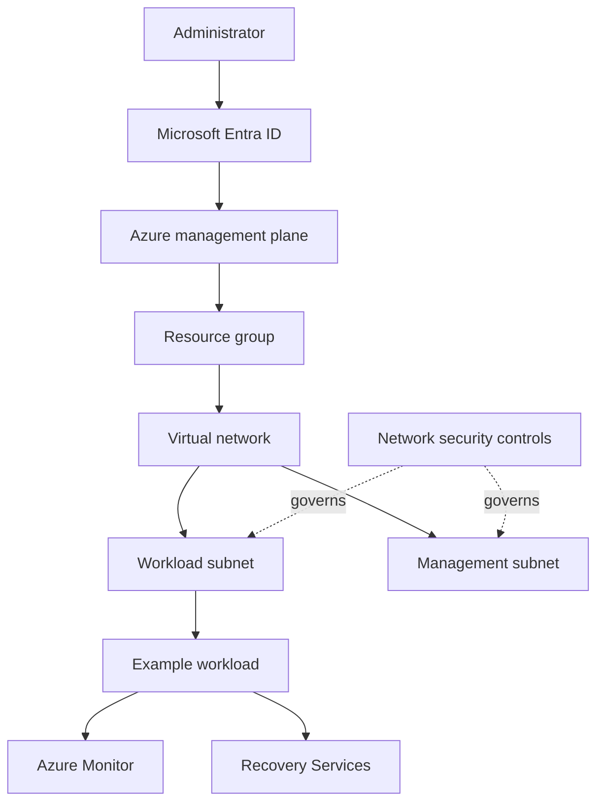

# Azure Cloud Labs

**Microsoft Azure | Hybrid infrastructure | Governance | Security | Operations**

My enterprise infrastructure background includes work across on-premises/datacenter platforms and Azure-related hybrid-cloud initiatives. This repository is where I organise practical Azure learning and technical exercises around the infrastructure disciplines that matter in production: governance, network design, identity, security, monitoring, backup and operational control.

**Important distinction:** this is an independent learning portfolio. The guides and starter templates do not, by themselves, claim a live Azure deployment or production implementation.

## Learning and engineering objectives

- Build a repeatable, secure and cost-aware Azure lab environment.
- Apply governance through resource groups, tags, locks and budgets.
- Understand virtual networks, subnets, NSGs and controlled connectivity.
- Explore identity, RBAC and secure administrative access.
- Configure monitoring, logging, backup and recovery exercises.
- Use infrastructure as code to make deployments reviewable and repeatable.
- Relate Azure services to hybrid infrastructure and operational requirements.

## Learning path

| Area | Exercise | Intended outcome |
|---|---|---|
| Governance | Resource groups, tags and locks | Organise and govern resources |
| Networking | Virtual networks and subnets | Design address spaces and segmentation |
| Network security | Network security groups | Apply controlled traffic rules |
| Compute | Virtual machine hardening | Secure administrative access |
| Observability | Azure Monitor and Log Analytics | Collect and investigate telemetry |
| Resilience | Backup and recovery | Understand protection and restoration |
| Identity | Microsoft Entra ID and RBAC | Apply least privilege |
| Hybrid | Connectivity reference design | Understand secure on-premises integration |

## Reference topology

## Published labs and templates

- [Lab 01 — Resource governance](labs/01-resource-governance/README.md)
- [Lab 02 — Network segmentation](labs/02-network-segmentation/README.md)
- [Lab 03 — Monitoring and alerting](labs/03-monitoring-and-alerting/README.md)
- [Lab 04 — Identity and RBAC](labs/04-identity-and-rbac/README.md)
- [Lab 05 — Backup and restore validation](labs/05-backup-and-restore/README.md)
- [Restore test record template](labs/05-backup-and-restore/TEST-RECORD-TEMPLATE.md)
- [Hybrid connectivity reference design](docs/HYBRID-CONNECTIVITY-REFERENCE.md)
- [Bicep network starter](bicep/network/main.bicep)

## Lab execution and evidence

For each exercise, the intended record is: objective, architecture, prerequisites, cost estimate, deployment steps, security considerations, validation evidence, cleanup and lessons learned. As labs are executed and validated, add dated evidence such as deployment output, screenshots with identifiers redacted, test results and concise lessons learned. Do not describe an exercise as deployed until it has actually been run and verified.

The current Bicep starter creates a virtual network and subnets. It has not been deployed or live-tested as part of this portfolio update.

## Safe lab practices

- Use a dedicated non-production subscription and least-privilege access.
- Set budget alerts and remove billable resources after exercises.
- Use synthetic resource names and parameterized templates.
- Never commit credentials, tokens, tenant IDs or subscription IDs.
- Check current Microsoft documentation and pricing before deployment.

This repository is a learning and demonstration space, not a claim of production Azure implementation. Validate all designs against current Azure guidance and your organisation's security and operational standards.
