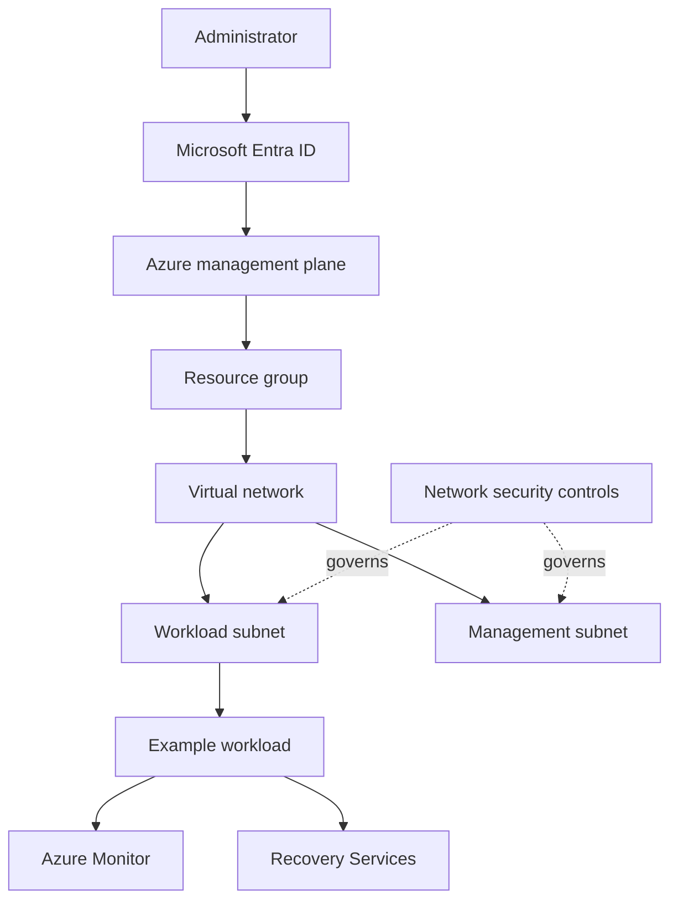

# Azure Cloud Labs

**Microsoft Azure | Hybrid cloud | Governance | Security | Operations**

Hands-on learning exercises for designing, deploying and operating secure Azure infrastructure. Labs should be repeatable, cost-conscious and safe for a personal test subscription.

## Lab principles

- Use a dedicated non-production subscription and least-privilege access.
- Set budget alerts and clean up billable resources after each exercise.
- Prefer parameterized templates and synthetic resource names.
- Never commit credentials, access tokens, tenant IDs or subscription IDs.
- Review current Azure documentation before applying portal or CLI steps.

## Learning path

| Level | Lab | Learning outcome |
|---|---|---|
| 1 | Resource groups, tags and locks | Organize and govern resources |
| 2 | Virtual networks and subnets | Understand address spaces and segmentation |
| 3 | Network security groups | Apply controlled traffic rules |
| 4 | Virtual machine hardening | Configure secure administration |
| 5 | Azure Monitor and Log Analytics | Collect and investigate telemetry |
| 6 | Backup and recovery | Understand protection and restoration |
| 7 | Identity and RBAC | Apply least privilege |
| 8 | Hybrid connectivity concepts | Understand secure on-premises integration |

## Reference topology

## Lab record template

For each lab, document:

1. Objective and prerequisites
2. Services and architecture
3. Estimated cost and budget safeguards
4. Deployment steps and configuration
5. Security considerations
6. Validation and expected results
7. Cleanup procedure
8. Lessons learned

## Example naming convention

Use generic names such as `rg-lab-network-01`, `vnet-lab-hub-01` and `vm-lab-app-01`. Do not use names copied from a work tenant.

## Published labs and templates

- [Lab 01 — Resource governance](labs/01-resource-governance/README.md)
- [Lab 02 — Network segmentation](labs/02-network-segmentation/README.md)
- [Lab 03 — Monitoring and alerting](labs/03-monitoring-and-alerting/README.md)
- [Lab 04 — Identity and RBAC](labs/04-identity-and-rbac/README.md)
- [Bicep — Lab virtual network](bicep/network/README.md)
- [Bicep source](bicep/network/main.bicep)

## Additional published references

- [Backup and restore validation lab](labs/05-backup-and-restore/README.md)
- [Restore test record template](labs/05-backup-and-restore/TEST-RECORD-TEMPLATE.md)
- [Hybrid connectivity reference design](docs/HYBRID-CONNECTIVITY-REFERENCE.md)

## Roadmap

- [x] Add a resource governance lab
- [x] Add a VNet and NSG lab guide
- [x] Add a monitoring and alerting exercise
- [x] Add identity and RBAC learning exercise
- [x] Add a reusable Bicep network starter
- [x] Add backup and restore validation
- [x] Add an Azure hybrid connectivity reference design

**Cost reminder:** these guides are learning material, not a promise of zero-cost execution. Review current pricing and clean up resources. The Bicep template creates only a VNet and subnets; it has not been deployed or live-tested as part of this portfolio update.
