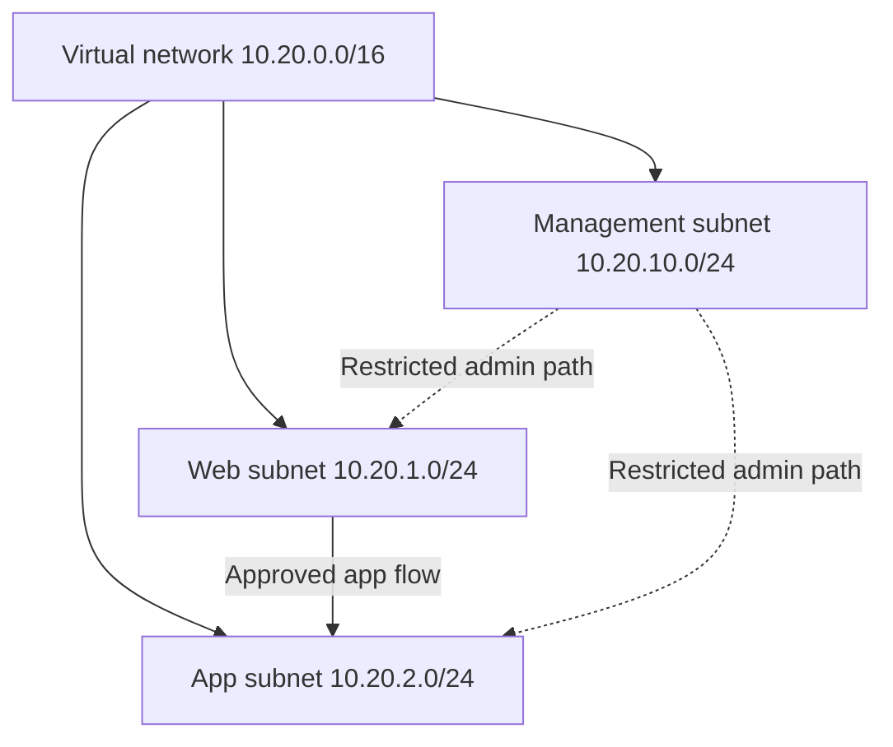

# Lab 02 — Azure Virtual Network and Segmentation

## Objective
Understand virtual networks, subnets, network security groups (NSGs), and controlled workload-to-management flows.

## Conceptual topology

The RFC1918 addresses are examples only. Plan address spaces to avoid overlap with existing networks before deployment.

## Exercise
1. Create a dedicated lab resource group and VNet.
2. Create separate web, application and management subnets.
3. Associate an NSG with each workload subnet.
4. Define only required flows; document source, destination, protocol, port, owner and justification.
5. Test permitted and denied connectivity from controlled lab VMs.
6. Review effective security rules and flow logs where available.

## Security principles
- Avoid exposing RDP or SSH directly to the internet.
- Use an approved secure administration path such as Bastion or a private management host.
- Use default-deny and explicit least-privilege rules.
- Treat NSGs as one layer, not a complete security architecture.

## Validation evidence
Capture sanitized screenshots or command output showing subnet associations, rule priorities and successful/blocked test cases. Remove public IPs, account identifiers and sensitive metadata before publishing.

## Cleanup
Delete only the dedicated lab resource group after verifying it contains no retained resources.
